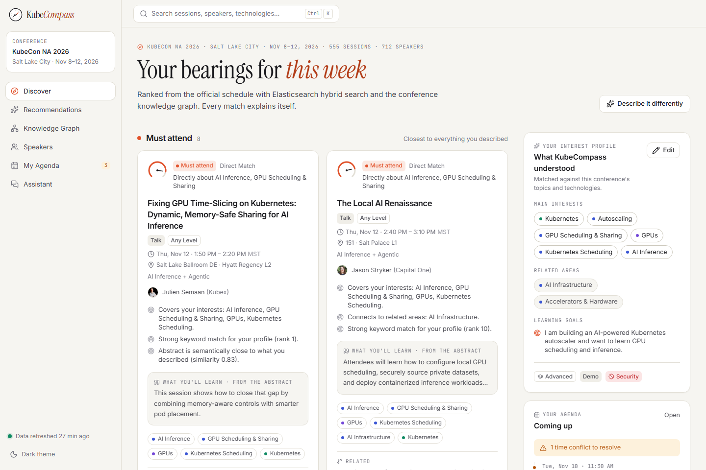
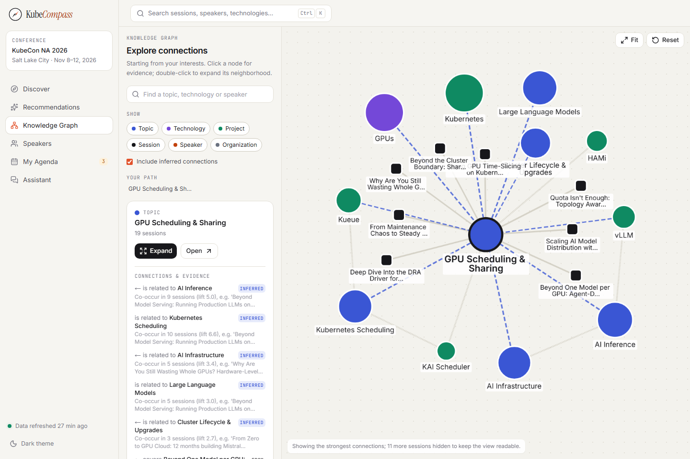
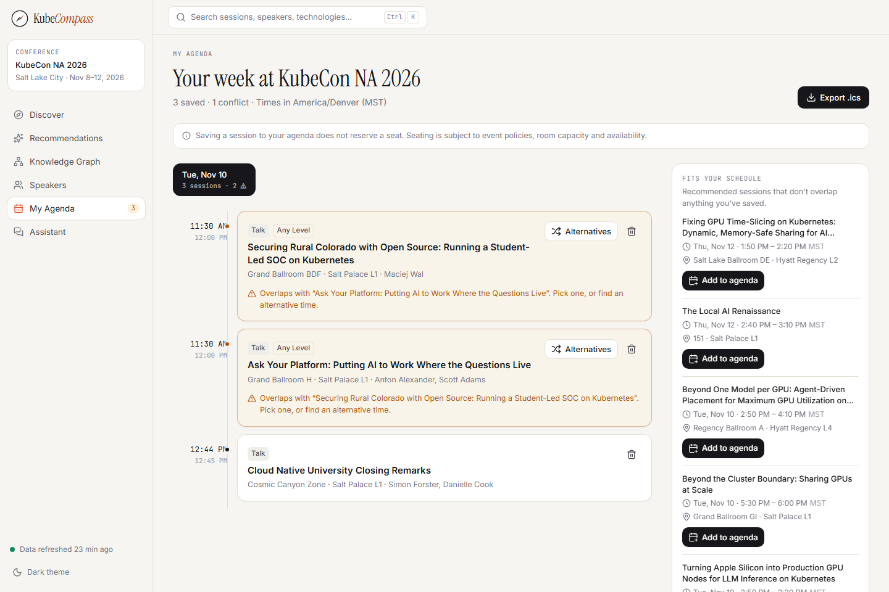
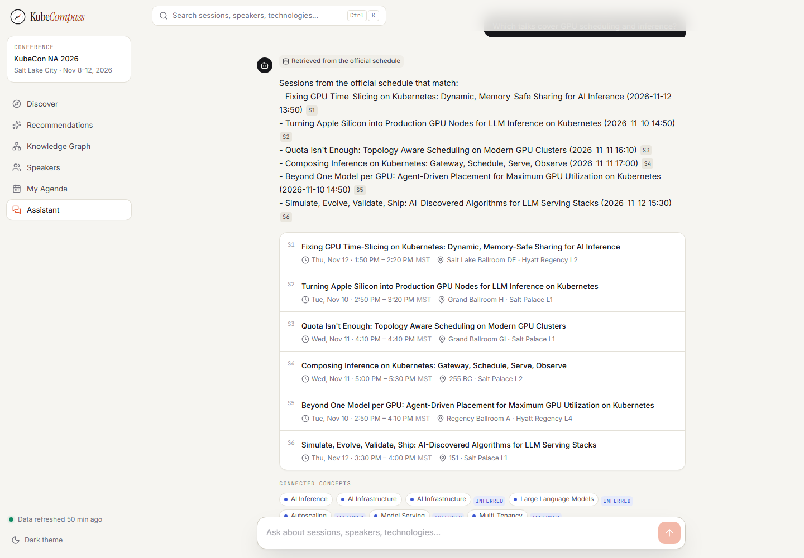
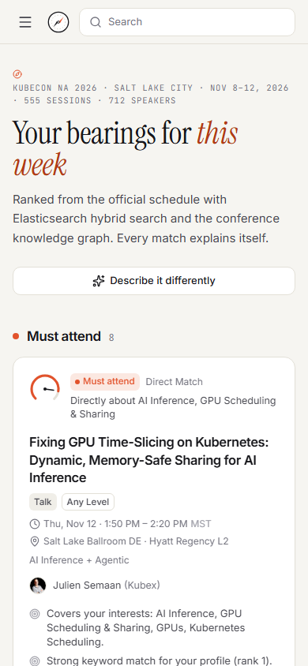
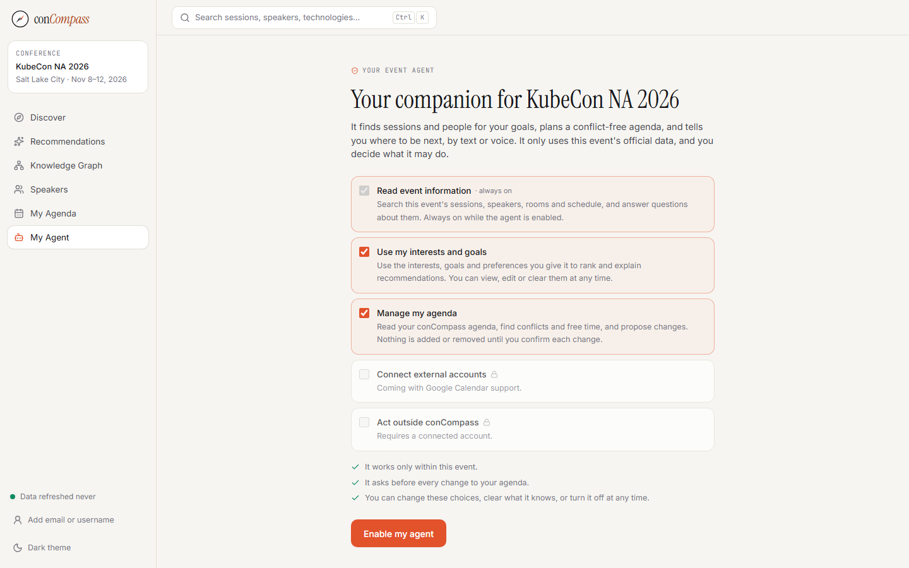
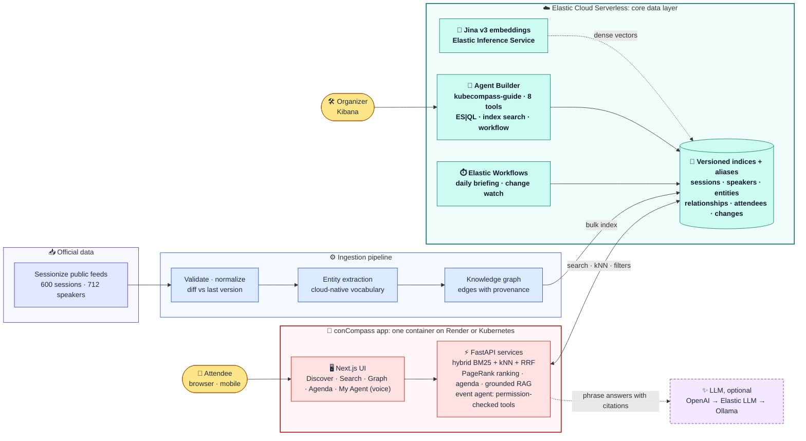
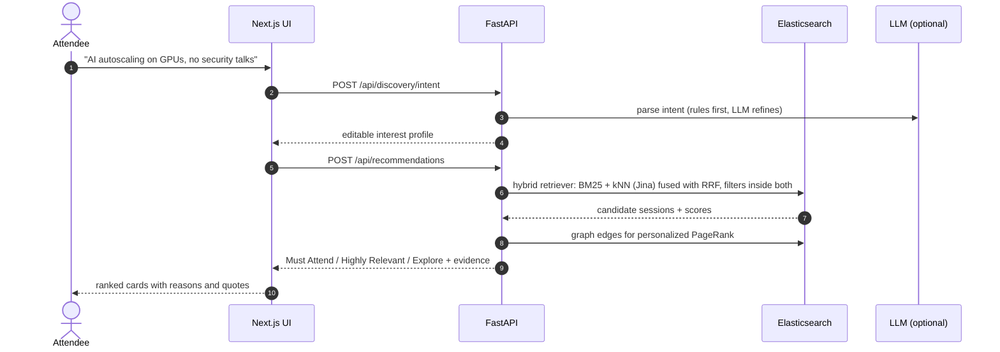

# conCompass

**Your AI event companion: an authorized agent that finds the right talks and people, plans your
agenda and tells you where to be next, by text or voice.**

conCompass (formerly KubeCompass) starts with KubeCon + CloudNativeCon North America 2026: 600
sessions and 712 speakers over five days. An attendee can
describe what they want to learn in plain language. It then returns the sessions, speakers and
technologies that matter, explains every match with evidence from the official schedule, and builds
a conflict-free agenda you can export to your calendar.

**Elasticsearch is the core data layer.** Every session, speaker, entity, relationship, attendee
agenda and schedule change is stored and queried in Elasticsearch: hybrid BM25 + vector search with
RRF, Jina embeddings through the Elastic Inference Service, ES|QL tools for an Agent Builder agent,
and Elastic Workflows for scheduled briefings.

> Built for the [WeMakeDevs Cloud Native Hackathon](https://www.wemakedevs.org/hackathons/cnh), Elasticsearch track ("Find the Right Talk").
> **Live demo:** [kubecompass.onrender.com](https://kubecompass.onrender.com/) (free tier: the first visit after idle can take ~1 min) · **Demo stack:** Elastic Cloud Serverless (GCP us-central1)



## Contents
- [What it does](#what-it-does)
- [Your event agent](#your-event-agent)
- [How Elasticsearch is used](#how-elasticsearch-is-used)
- [Search quality (measured)](#search-quality-measured)
- [Architecture](#architecture)
- [Quick start](#quick-start)
- [Deploy](#deploy)
- [Accessibility and inclusion](#accessibility-and-inclusion)
- [Tests](#tests)
- [AI assistance disclosure](#ai-assistance-disclosure)
- [Limitations](#limitations)

## What it does
| Feature | What the attendee gets |
|---|---|
| **Discover** | "I'm building an AI-powered Kubernetes autoscaler, avoid security talks" → an editable interest profile → **Must Attend / Highly Relevant / Explore** tiers, each with reasons, a verbatim "what you'll learn" quote from the abstract, and the real score breakdown |
| **Search** | Hybrid, keyword or semantic search; filters for day, format, level and track; ⌘K autocomplete; synonyms (e.g. `k8s` → Kubernetes) |
| **Knowledge graph** | An interactive explorer of topics, technologies, CNCF projects, sessions, speakers and organizations. Every edge shows where it came from: official schedule, extracted from text (with the sentence), curated vocabulary, or inferred |
| **My Agenda** | Detects time conflicts, tight building changes and free gaps, suggests alternatives, shows schedule-change notices, and exports `.ics` in `America/Denver` with a proper VTIMEZONE. No account is needed |
| **My Agent** | A personal agent you enable and authorize per event. It answers grounded questions (with `[S#]`/`[P#]` citations), says what's next and where, fills free time, builds a conflict-free plan, and proposes agenda changes you confirm. Works by voice or text |
| **Elastic agent** | The `kubecompass-guide` Agent Builder agent answers in Kibana using 8 custom tools (ES\|QL, index search, workflow) |

| | |
|---|---|
|  |  |
|  |  |

## Your event agent


- **Authorized, not assumed.** The agent is off until you enable it for an event and choose its
  permissions: read event data (always), use your interests and goals, and manage your agenda.
  With Google Calendar configured, you can also connect your calendar and allow syncing. Permissions are checked on the
  server by every tool; you can change them, clear what it knows or turn it off at any time.
- **Acts only with confirmation.** "Add the GPU time-slicing talk to my agenda" returns a
  confirmation card; nothing changes until you tap **Yes, add it**. Confirmed actions are
  idempotent and listed in your permissions panel.
- **Time-aware.** "What should I attend next?", "Where is my next session?", "I have 30 minutes
  free", "What's happening right now?", "Build my agenda for Wednesday", "Any conflicts?".
- **Voice.** Push-to-talk speech input and spoken replies (browser speech APIs behind swappable
  interfaces). There's no background listening, unclear transcripts are shown for review, and text
  always works.
- **Grounded.** Open questions go to the citation-checked RAG answerer; replies come with session
  and speaker cards, and **How I got this** shows the tools used.
- **Installable** on a phone's home screen (web app manifest).

Design and permission model: [`docs/AGENT.md`](docs/AGENT.md). Audit and roadmap (Google Calendar,
organizer workspace, Luma): [`docs/CONCOMPASS_AUDIT.md`](docs/CONCOMPASS_AUDIT.md).

## How Elasticsearch is used
Elasticsearch is where the data lives and where every feature gets its answers.

| Capability | Where |
|---|---|
| **Versioned indices behind aliases**: `conference_sessions`, `_speakers`, `_entities`, `_relationships`, `_attendees`, `_changes`. A refresh builds new indices and swaps the aliases atomically, so a bad payload never replaces good data | `backend/app/search/indexer.py`, `elasticsearch/mappings/` |
| **BM25** with a custom analyzer, a cloud-native synonym set, field boosts and `search_as_you_type` autocomplete | `elasticsearch/`, `backend/app/search/` |
| **Dense vectors + kNN**: Jina `.jina-embeddings-v3` (1024-d) via the Elastic Inference Service on Elastic Cloud, or local `bge-small` offline | `backend/app/infrastructure/embeddings.py` |
| **`semantic_text`** field with the inference endpoint attached, so Elastic chunks and embeds the text itself | session mapping |
| **Hybrid retrieval**: native `rrf` retriever (BM25 + kNN), with the same filters applied inside both retrievers | `backend/app/search/` |
| **Recommendations**: hybrid retrieval → personalized PageRank over the graph → configurable scoring (`ranking.yaml`) → tiers. Similarity thresholds are calibrated per embedding model | `backend/app/recommendation/`, `deployment/configuration/` |
| **Graph edges** are stored as documents with provenance (`explicit` / `extracted` / `curated` / `inferred`) and read from Elasticsearch | `backend/app/knowledge_graph/` |
| **Agent Builder**: the `kubecompass-guide` agent with 8 tools: 2 index-search tools, 5 parameterized **ES\|QL** tools (sessions on a day, by speaker, topic coverage, entity connections, topic on a day) and a workflow tool | `elasticsearch/agent-builder/` |
| **Elastic Workflows**: a daily 07:00 Denver briefing, an hourly schedule-change watch and on-demand topic briefings, stored in `kubecompass-briefings` | `elasticsearch/workflows/` |
| **Provisioning as code**: `kubecompass elastic setup` creates the workflows, tools and agents idempotently, and `check` verifies them | `backend/app/elastic/` |

Details: [`docs/SEARCH_DESIGN.md`](docs/SEARCH_DESIGN.md) · [`docs/ELASTIC_CLOUD.md`](docs/ELASTIC_CLOUD.md) · [`docs/KNOWLEDGE_GRAPH.md`](docs/KNOWLEDGE_GRAPH.md)

## Search quality (measured)
`uv run kubecompass evaluate` runs 12 representative attendee queries with graded relevance (pooled
top-10 of every method, local `bge-small` embeddings):

| Method | P@5 | R@10 | nDCG@10 | latency |
|---|---|---|---|---|
| BM25 | 0.850 | 0.609 | 0.735 | 20 ms |
| Vector (kNN) | 0.883 | 0.615 | 0.708 | 38 ms |
| **Hybrid, native ES RRF** | 0.867 | **0.655** | **0.771** | 44 ms |
| Hybrid + graph re-rank | 0.850 | 0.660 | 0.796 | 79 ms |

Hybrid beats either retriever alone on recall and nDCG. The relevance labels were produced with AI
assistance, not by independent human judges, and 12 queries is a small set. Treat these numbers as
indicative; we don't claim the graph re-rank helps in general.

## Architecture
**System overview.** Elasticsearch sits at the center: it stores every record and answers every query.



**One recommendation request, end to end:**



- **Works without an LLM.** Rule-based intent parsing and extractive answers are the baseline; an
  LLM only improves the wording. Providers fail over automatically, with a daily call cap.
- **Real data only.** Nothing is invented; fields missing from the source are shown as unavailable.
- **Conference-agnostic.** A new conference is a YAML file in `deployment/configuration/conferences/`.

More: [`docs/ARCHITECTURE.md`](docs/ARCHITECTURE.md) · [`docs/RECOMMENDATION_ENGINE.md`](docs/RECOMMENDATION_ENGINE.md) · [`docs/DECISIONS/`](docs/DECISIONS/)

## Quick start
### Option A: fully local (Docker, no cloud account)
Requires Docker with about 4 GB of free memory.
```bash
git clone https://github.com/Ngoga-Musagi/kubecompass.git && cd kubecompass
cp .env.example .env              # optional: add OPENAI_API_KEY for AI-written answers
docker compose up -d --build      # Elasticsearch :9200 · API :8000 · UI :3000
```
On first start the backend ingests `data/raw/*.json` and downloads the embedding model (1–2 min).
Then open http://localhost:3000.

### Option B: Elastic Cloud Serverless (Jina, Agent Builder, Workflows)
1. Create an **Elasticsearch** Serverless project ([free trial](https://cloud.elastic.co/registration)).
   Copy the endpoint and create an API key.
2. Configure and run:
```bash
cp .env.cloud.example .env.cloud  # endpoint, API key, Kibana URL
make cloud-check                  # connectivity + Jina inference endpoint
make cloud-ingest                 # index the schedule with Jina embeddings
make cloud-setup                  # create Workflows, Agent Builder tools and agents
make cloud-up                     # UI + API on :3000 / :8000 against the cloud
```
Full guide: [`docs/ELASTIC_CLOUD.md`](docs/ELASTIC_CLOUD.md).

### Option C: local development (no Docker for the app)
Requires Python 3.12+ with [uv](https://docs.astral.sh/uv/), Node 22+ and Docker (for Elasticsearch).
```bash
docker compose up -d elasticsearch
cd backend && uv sync && uv run kubecompass ingest   # validate → normalize → graph → embed → index
uv run uvicorn app.main:app --port 8000              # API, OpenAPI docs at /docs
cd ../frontend && npm ci && cp .env.example .env.local && npm run dev   # UI at :3000
```
Run `make help` to list the shortcuts.

## Deploy
The app ships as one container (UI + API, about 240 MB RAM). The data and Elastic features stay in
Elastic Cloud.
- **Render (free):** [`render.yaml`](render.yaml) is a Blueprint. In Render, choose New → Blueprint
  and pick this repo, then enter `KUBECOMPASS_ES_URL`, `KUBECOMPASS_ES_API_KEY` and `OPENAI_API_KEY`.
- **Kubernetes:** [`deployment/kubernetes/`](deployment/kubernetes/) holds the Deployment, Service
  and ConfigMap, with a non-root user, probes and resource limits. `kubectl apply -k` deploys them;
  tested on kind.
- **Google Cloud Run and others:** [`docs/DEPLOYMENT.md`](docs/DEPLOYMENT.md), which also has the
  public-safety checklist: a least-privilege Elastic key, AI budget caps and rate limiting.

## Accessibility and inclusion
- No sign-up needed. To keep your interests and agenda across devices, add an **email or a username**
  (sidebar → *Add email or username*); a username works just as well if you'd rather not share an email.
  The server never stores the handle, only a one-way HMAC-derived ID. Without one, your session
  belongs to that browser tab only, so the next visitor never sees it.
- All times are shown in the venue's time zone (`America/Denver`) with the zone label, so remote and
  international attendees aren't confused by their device time zone.
- Keyboard-first: ⌘K/Ctrl K search, visible focus rings, ARIA labels and live regions, and
  screen-reader text on icon buttons.
- `prefers-reduced-motion` is respected, with light and dark themes and a responsive mobile layout.
- Each explanation states its evidence in plain language, so you don't need to know the jargon
  ("GPU sharing" also finds "time-slicing" and DRA talks).

## Tests
```bash
cd backend && uv run ruff check app tests && uv run mypy app && uv run pytest tests -q
cd frontend && npm run typecheck && npm run lint && npm test
cd frontend && npx playwright install chromium && npx playwright test   # needs a running stack
```
Latest run: **95 backend tests** (unit + integration against real Elasticsearch, including the full
agent authorization flow), **16 frontend unit tests**, and **8 Playwright tests** (attendee journey,
graph, event agent and per-user personalization) on desktop and mobile. All pass against the single
deploy container. ruff and mypy are clean.

## Data
The data is the official public Sessionize feeds for KubeCon + CloudNativeCon NA 2026 (event
`svi82w6c`), stored in `data/raw/`. Run `uv run kubecompass ingest --remote` to fetch the live
feeds. A refresh is checked against the current data, and a suspicious payload (for example, more
than 30% fewer sessions) is rejected while the previous version keeps serving.
See [`docs/DATA_PROVENANCE.md`](docs/DATA_PROVENANCE.md).

## AI assistance disclosure
As the hackathon rules require, I'm disclosing my use of AI coding assistants. I (Ngoga Musagi)
designed the product, the requirements and the architecture decisions, and I directed and reviewed
the implementation. Much of the code, tests and docs was written with **Claude Code** (Anthropic)
working from those specifications. The project-specific Claude Code skills and commands used during
the build are in [`.claude/`](.claude/), and the contributor guide is in [`CLAUDE.md`](CLAUDE.md).
At runtime the app can optionally call an LLM (OpenAI, Anthropic, Elastic's managed LLM or a local
Ollama model) to phrase answers. Every answer must cite indexed records.

## Limitations
- The search-evaluation labels were produced with AI assistance (12 queries), not independent human judges.
- Topic extraction is vocabulary-based, so concepts outside `deployment/configuration/vocabulary/` aren't linked.
- Sessionize has no public per-session URL for these ids, so links point to the official schedule.
- Email/username personalization has no password: anyone who enters the same handle sees the same agenda (OAuth sign-in is planned with Google Calendar). Change notices appear in the app, not as push notifications.
- Voice uses the browser's speech services: quality depends on the browser (Chrome, Edge and Safari support input; Firefox is text-only), and Chrome sends audio to its speech service.
- The agent routes requests with rules, not an LLM planner; unusual phrasings fall back to grounded search.
- Google Calendar sync needs a Google OAuth client ([setup](docs/GOOGLE_CALENDAR.md)); while that app is in Google's *Testing* mode only listed test users can connect.
- Not built yet: the organizer workspace and providers other than Sessionize (see the audit).
- Security is disabled on the local Compose Elasticsearch, which is for development only. Elastic Cloud is secured.

## License
[MIT](LICENSE)
